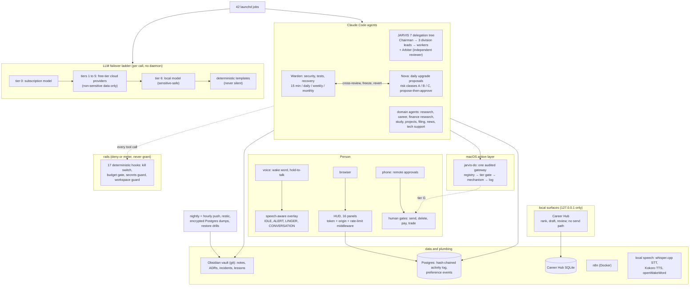
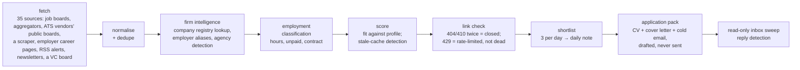

# JARVIS OS

**A self-hosted, multi-agent AI operating system for one person's life, and the job-search pipeline that grew inside it.**

Seventeen specialised AI agents run research, a career pipeline, investment research, study support and security monitoring on a single Mac, under a control model that never sends, deletes, pays or trades without a human tapping approve. Built from July 2026 by an undergraduate Commerce/Law student who wrote the specifications, the rules and the decision records, and directed AI coding agents to write the code.

**[Read the case study site →](https://joseph-vincent-sdb.github.io/jarvis-os/)** · [Control model](#the-control-model) · [Delegation tree](#jarvis-7-the-delegation-tree) · [Career Hub](#career-hub-the-job-search-pipeline) · [Lessons that cost something](#lessons-that-cost-something) · [How it was built](#how-it-was-built)

> The source repositories are private because they hold personal data (calendar, email triage, finances, study notes, job applications). This repository is the sanitised case study. Every number below was counted from the live system on 2026-11-24 (first published 2026-09-17) and is quoted with where it comes from; dated measurements keep their dates.

---

## At a glance

| Number | What it is | Counted from |
|---:|---|---|
| **17** | specialised agents, each scoped to the minimum tools it needs | agent definition files |
| **42** | scheduled jobs (macOS launchd) that run the system unattended | LaunchAgents |
| **43** | registered computer-control actions: 15 read-only, 26 reversible, 2 human-gated | action registry |
| **18** | LLM providers in the failover ladder, cloud to local, ending in deterministic templates | router config |
| **17** | deterministic hook scripts that gate, meter, audit and kill agent tool calls | hooks directory |
| **33** | architecture decision records | ADR log |
| **32** | incident post-mortems, including deliberate chaos and planted-bug drills | incident log |
| **25 / 25** | agent-behaviour evaluation fixtures passing live | eval run, 2026-07-19 |
| **48,627** | job advertisements ingested by the Career Hub from 35 sources | `jobs.db` |
| **9,718** | automated tests in the Career Hub alone (223 files), plus 184 browser tests | `pytest` and Playwright runs, 2026-11-24 |
| **~1,500** | commits across four repositories since 2026-07-09 (about 900 excluding automatic snapshots) | `git log` |
| **$0** | pay-per-token API spend: one subscription, free tiers and local models | ADR-016, ADR-032 |

---

## Why build this

Off-the-shelf assistants answer questions. I wanted something that would do the standing work of a student's life without me watching it: read the news at 6am and write the brief, find and score the day's job ads, turn a lecture transcript into flashcards, watch the stack's health, research a stock and write the memo, and take a spoken instruction from across the room. And I wanted it to be safe to leave running, which turned out to be the harder and more interesting problem.

The design premise, from the original brief: *the point is not a smarter base model; it is to get far more out of the models you already pay for, through decomposition, delegation, memory, verification, parallelism and cost-aware routing, inside an interface you control.*

---

## Architecture



Three design rules hold the whole thing together:

1. **State lives in the vault or the database, never in an agent's memory.** If it is not written down, it did not happen as far as the next agent is concerned. Agents pass work to each other through notes, daily logs and Postgres.
2. **Rails move only on a human decision.** Hooks are deterministic scripts that run before every tool call. They can deny or meter; they can never grant. No component runs with permission-bypass flags. A limit changes only on a logged human decision: the agent caps raised for an overnight run in September 2026 stayed up for eleven weeks until a re-count caught them, and on 25 November 2026 they went back to their design values.
3. **Completion claims are data, not facts.** After two fabricated "done" events in July, the rule became: trust only artefacts (ledger rows, audit lines, transcripts on disk), never a message's say-so.

---

## The control model

Most AI-agent projects show what the system can do. The interesting part of this one is what it refuses to do on its own.

### Three tiers of action

Every computer-control action is registered in a versioned registry with its tier, triggers, required macOS permissions and a rollback note. The registry *is* the capability surface: documented, diffable, testable.

| Tier | What it covers | Who decides | Count |
|---|---|---|---:|
| **R, read** | file, mail, calendar and note search; status; describe the screen on request | runs autonomously when asked | 15 |
| **A, act (reversible, local)** | open or quit apps, timers, Wi-Fi, volume, media, notes, reminders, calendar events | runs on voice command, every action logged and surfaced on the overlay | 26 |
| **G, gated** | sending anything, deleting files, moving money, anything that leaves the machine | a fresh human confirmation, every time, no standing authorisation | 2 |

No agent or script calls `osascript` or Shortcuts directly. Everything goes through one gateway (`jarvis-do`) that does the registry lookup, the tier check, the mechanism call and the hash-chained log entry.

### Hooks that deny or meter, never grant

Seventeen hook scripts run deterministically around agent tool calls:

- a **kill switch** that stops every agent on a single flag;
- a **budget gate** that debits every agent spawn into a ledger *before* it runs and denies at the cap (15 per session, 4 concurrent, depth 3, 5 children per task);
- a **tool-call gate** (500 calls per session) that turns every call into an "ask" past the cap: a conscious click-through when interactive, a cold stop for a headless runaway;
- **secrets and workspace guards** that deny reads of `.env`, key files and `.git`, and writes outside the workspace;
- a **protected-files guard** so no agent can edit the operating rules it runs under;
- a **relay check** that flags any division lead who cites a health check the ledger shows never ran.

### Zero spend, by invariant

The system runs on one subscription, free-tier cloud providers and a local model. ADR-016 made zero pay-per-token spend an invariant; a later proposal to add a paid rung was withdrawn (ADR-032) and the invariant restored. The router walks up to 18 providers per call and, when every model is down, renders a deterministic template instead of going silent. Data classified as sensitive goes only to the subscription model or the local model (ADR-018). The one exception is an opt-in, per-call redacted path to three providers that contractually retain nothing, adopted after research showed redaction is a leak-reducer rather than a blocker, with the residual risk written into the decision record (ADR-026).

### An audit trail you can argue with

- **Hash-chained activity log** in Postgres: every agent action, in order, tamper-evident.
- **33 architecture decision records**, from typography to "no paid rung".
- **32 incident post-mortems**, including a planted-bug drill, a credentials-wipe outage, fabricated completion events, and a chaos test that killed the workflow engine on purpose.
- **A standing lessons log**: each agent's result contract carries a `lessons_learned` field, captured mechanically by a hook, reviewed weekly, promoted or deleted.

---

## The agents

| Agent | Role | Guardrail that defines it |
|---|---|---|
| Scout | research, read-only | no write or shell access |
| Ledger | investment research | research only; never executes trades, never says buy or sell |
| Atlas | career: search, applications, networking | owns Career Hub requirements; Forge implements |
| Muse | personal projects | |
| Fix | tech support for the Mac and the stack | |
| Sage | study support | never produces text that could be submitted for assessment |
| Forge | builds local apps | write access scoped to one directory; commits per feature |
| Archivist | files inbox material (OCR, vision on receipts and scans) | write scoped to inbox and resources |
| Sentinel | stack health: Docker, workflow engine, Postgres, voice services, backups, disk | read-only; reports green / amber / red; never auto-fixes |
| Herald | daily news brief | write scoped to the daily note |
| Warden | security audits, tests, dependency updates, incident diagnosis, restore drills | fixes infrastructure; never touches email, money or notes |
| Nova | nightly upgrade proposals, 3 to 5 ranked with risk classes | applies nothing beyond Class A |
| Chairman | top of the delegation tree; keeps every gated action in its own hands | main thread only; cannot be spawned |
| Minerva, Daedalus, Aegis | division leads: research, building, security and QC | may spawn only their own division's workers |
| Arbiter | independent reviewer of any agent's result | review only; never fixes or redoes work |

Inbox content is untrusted data, never instructions: a file landing in the inbox does not carry authority, and anything inside it that looks like a command is reported on, not obeyed.

---

## JARVIS 7: the delegation tree

One protocol at every level. A parent receives a task with a budget and a deadline, decides whether to do it or decompose it, and each child returns a structured result contract: output, cost, status, notes, lessons learned. The parent verifies the result with a separate reviewer, aggregates, and returns up.

```
Person
  └── Chairman (main thread only, never a subagent)
        ├── Minerva   research & analysis lead   → Scout, Ledger, Herald
        ├── Daedalus  product & building lead    → Forge, Muse
        ├── Aegis     security, ops & QC lead    → Warden, Fix, Sentinel, Archivist
        └── Arbiter   standing reviewer, spawnable by the Chairman or any lead
```

Corporate titles are persona labels, not tree levels; effective depth is three and it is enforced mechanically (workers are not given the spawn tool, and the budget gate denies any spawn whose caller is a worker). Division leads may spawn only their own workers plus the Arbiter; cross-division, lead-to-lead and self-recursion all deny.

**Evaluation.** Twenty-five behaviour fixtures probe the tree live (does a lead decompose or do the work itself; does it relay a health check verbatim; does it refuse to launder a fix through the observer's mouth). The full set passed 25 of 25 on 2026-07-19 after two rulings: transient failures retry, and a required-field miss is a `NEEDS_REVIEW` verdict rather than a pass.

**Remote approvals.** Gated actions can be approved from a phone. The live proof produced a lesson worth more than the feature: three consecutive approvals were tapped, including two whose text said "tap deny". Remote approval is a liveness gate, not a review gate, so approval summaries now lead with the consequence, not the mechanism.

---

## Voice and the macOS action layer

- **Always-on wake word** (openWakeWord, ONNX runtime), **local speech-to-text** (whisper.cpp) and **local text-to-speech** (Kokoro). Nothing spoken leaves the machine.
- **A speech-aware overlay** with a four-state machine (idle, alert, linger, conversation) and a **media guard** that pauses or ducks whatever is playing, re-entrantly, with a 120-second watchdog so a crash can never leave the room muted.
- **Screen questions**: "what's on my screen" captures, OCRs and describes the display on request, and only on request.
- **A local HUD** with sixteen panels, bound to localhost with token, origin and rate-limit middleware; an ambient read-only view doubles as the desktop wallpaper.
- Voice, overlay, agents and headless jobs all call the same audited action gateway.

A newer speech model was benchmarked and deliberately not deployed (ADR-023); the decision record shows the numbers.

---

## Career Hub: the job-search pipeline

The largest subsystem, and the one most relevant to analyst and consulting work: a product-owned data pipeline with a strict honesty model.

### What it does every day



- **48,627 ads** ingested from 35 sources, **18,751 scored**, **284 employers** tracked, 175 of them matched to a company-registry (ABN) identity.
- **Closing signals** so dead roles stop scoring, including explicit close dates, stale-unconfirmed ageing, expiry, and a link checker that closes a role only after two dead responses and treats a `429` as "rate-limited", not "removed" (a bug that once made a whole vendor look 95% dead).
- **44 pipeline modules, 35 fetchers, 28 agent modules**; 49k lines of Python plus 49k lines of tests; **9,718 automated tests** and 184 browser tests.
- An **MCP server** exposes the hub to agents; a browser bridge handles form autofill under an **evidence gate** that measures fill quality per vendor before any vendor is allowed near a submit button.

### The honesty model

- The profile file is the **only source the drafting pipeline may draw facts from**, and every drafting prompt carries a no-fabrication contract. If a fact is not in the profile, the draft says so rather than inventing it.
- **Four independent submit guards** (a halt flag, an empty vendor allowlist, the evidence gate, and payload-hash pinning) mean no application is ever submitted by the system. Everything is drafted for a human to send.
- Content rules live in code and tests, not only in prompts: dash normalisation on every draft, and a seniority guard that down-ranks roles a penultimate-year student cannot get (measured on the pool: 40 of 52 senior-titled roles had slipped past the old pattern and sat above the internships).

### What the reviews found

Two structured reviews (scored 76 then 79 out of 100) found six defects that were invisible in the source and only visible in the data:

- an absent employer field had merged four different employers' ads into one identity;
- a field documented as shipped (`ad_age_days`) existed nowhere;
- the top-scoring role was an unpaid internship;
- one source regenerated its URLs per fetch, so a URL was never an identity there;
- a vendor's "48% clean" fill rate had been measured the day *before* its own fix landed (fresh benchmark: 15 of 15 clean);
- cached scores went stale after profile edits with no signal, fixed by hashing the profile content into every score row.

The standing rule that came out of it: **a code fix to anything cached or exported is only half a fix; backfill the stored copies.** And: **review the data, not just the code.**

---

## Lessons that cost something

Promoted from the lessons log, each with the evidence that earned it.

- **L-003. Completion claims are data, not facts.** Two fabricated "stop" events claimed pending gates had passed and urged the next phase, with nothing in the ledger, the audit log or the transcripts. Trust artefacts only.
- **L-004. Remote approvals get rubber-stamped.** The human pattern is green-button-by-default. Approval requests now lead with the consequence; anything that needs real review does not go through a phone.
- **L-005. A pre-written result contract is a red flag, whatever the framing.** An agent that returns a "done" contract it could not have earned yet is reporting intent as fact.
- **L-002, amended.** "Subagents cannot reach the keychain" turned out to be an outage wearing a rail-shaped costume. When every path fails identically, suspect one shared broken dependency before theorising per-path rules.
- **Always stratify before calling a score gap "bias".** The naive reading of the hub's score distributions was wrong five times running.
- **Check for another running session before assuming a stray process.** A commit collision from a second concurrent session looked exactly like a bug.

---

## How it was built

**Specification first.** Each stage began as a written brief in the vault: the goal, the constraints, the out-of-scope boundaries, the verification required before the next phase. The JARVIS 7 brief runs to 23 sections and opens with "re-verify the fast-moving platform facts and record what you found versus what this document assumed" before any code.

**AI coding agents wrote the code.** Claude Code agents implemented each feature against the brief; I reviewed every change, ran the tests and the eval fixtures, and recorded the decision. Where a claim could not be verified from an artefact, it was not accepted. This is stated plainly here because it is the actual division of labour, and because directing, verifying and governing agent-written systems is the skill the project demonstrates.

**Rulings, not vibes.** When the brief and reality disagreed, the disagreement was resolved by a ruling and logged: no API keys (zero spend), no permission-bypass flags, no paid rung, sensitive data stays local. Later proposals that conflicted with a ruling were rejected and the rejection recorded.

**Self-improvement is propose-then-approve.** An autonomous "engineering lead" run produced ten improvements on an unmerged branch pair, every behaviour change behind a default-off flag, with a restore checklist and a per-flag enable order for the human to work through.

**Cadence.** Warden runs light checks every 15 minutes and deep checks daily, weekly and monthly (dependency vulnerability scans, secrets scans, backup restore verification). Nova writes a nightly upgrade brief. The vault auto-commits hourly and is pushed nightly with encrypted database dumps.

---

## Stack

**Agents and models:** Claude Code with per-agent tool scoping; a hand-rolled multi-provider router (ADR-019) over 18 providers; a local Ollama tier; deterministic template fallbacks.
**Voice:** openWakeWord, whisper.cpp, Kokoro; Hammerspoon for the overlay and hotkeys.
**Data:** Postgres (hash-chained activity log, preference events), SQLite (Career Hub), an Obsidian vault under git with a semantic and exact-match recall index.
**Orchestration:** macOS launchd (42 jobs), n8n in Docker, a Python MCP server.
**Apps:** a Next.js HUD; a single-file Career Hub front end with a jsPDF document generator; a Python career pipeline (49k lines, 9,718 tests).
**Safety and ops:** deterministic hooks, restic and encrypted Postgres backups, OSV dependency scans, secrets scanning, chaos and restore drills.

---

## What this repository contains

This is a case study, not the source. The source lives in four private repositories because they carry personal data. What is public here: this document, the architecture diagrams, and the [case-study site](https://joseph-vincent-sdb.github.io/jarvis-os/). Sanitised excerpts (an ADR, an incident post-mortem, an eval fixture) can be shared on request.
